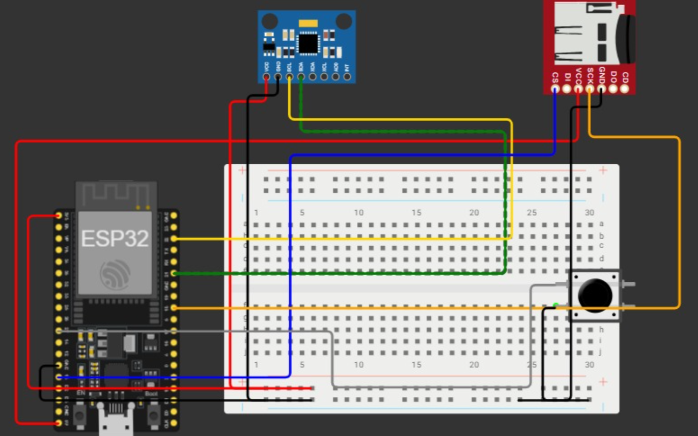
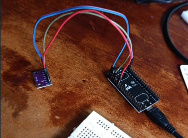
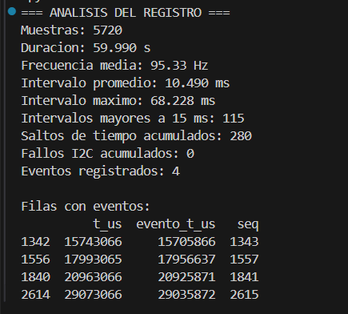
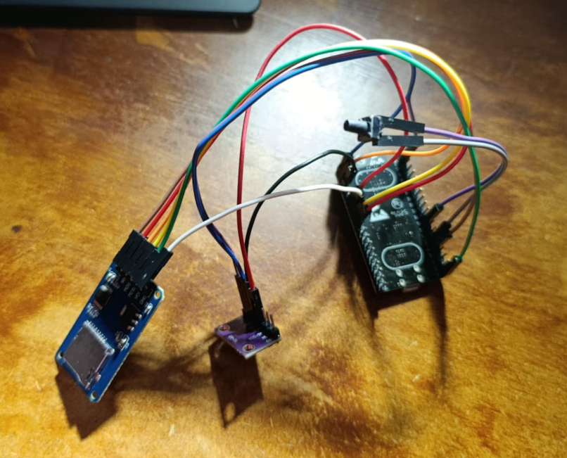

## Entrada 001 — Adquisición de componentes

**Fecha:** 20/11/2026
**Actividad:** Compra de los componentes para la elaboración del proyecto

### Objetivo

Adquirir los componentes necesarios para construir el prototipo.

### Esquema



Se elaboró un esquema del proyecto en Thinkercad para crear el plan de trabajo y planificar los componentes que se necesitarían al momento de implementar el circuito del prototipo.

### Componentes

- ESP32 WROOM-32D
- GY-91 (MPU-9250 y BMP280 responden por I²C)
- Lector microSD SPI
- microSD de 16 GB
- Pulsador de dos patas
- Cable micro-USB
- Protoboard y jumpers


### Procedimiento

Se compararon cotizaciones de distintas tiendas de electrónica y se seleccionaron los componentes de acuerdo con los requisitos del proyecto.

### Decisiones

Se eligió un GY-91 para reunir los sensores inerciales y barométricos en una sola placa.

### Pendientes

- Comprobar comunicación I2C.
- Comprobar el lector microSD.

### Uso de IA

Se utilizó IA para comparar compatibilidad y planificar el montaje. Sus recomendaciones están pendientes de validación física.

## Entrada 002 — Identificación de componentes y preparación del ensamblaje

**Fecha:** 21/11/2026
**Actividad:** Inspección física de los componentes y preparación del primer montaje.

### Objetivo

Identificar los pines y las características principales de los módulos adquiridos para establecer conexiones seguras y preparar las primeras pruebas de comunicación.

### Componentes inspeccionados

- **ESP32-WROOM-32D:** placa de desarrollo de 38 pines, con puerto micro-USB y conversor USB-serie CP2102.
- **GY-91:** módulo multisensor con conexiones I²C y SPI. Se observa un circuito integrado con marcado compatible visualmente con la familia MPU-9250, pendiente de verificación electrónica.
- **Lector microSD SPI:** módulo de seis pines con regulador de 3,3 V identificado en la placa.

### Decisiones técnicas

Se utilizará comunicación I²C entre el ESP32 y el GY-91, mediante GPIO21 (SDA) y GPIO22 (SCL).

Se verificará primero la comunicación y la identidad de los sensores antes de incorporar el sistema de almacenamiento microSD.

### Evidencias

Fotografías de ambas caras del ESP32, GY-91 y lector microSD, almacenadas en `documentacion/fotografias/`.

**ESP32:**


**GY-91:**


Lector microSD:


### Estado

Inspección visual realizada. Pendiente de confirmar comunicación eléctrica, identificadores de sensores y adquisición de datos.

### Uso de IA

Se utilizó ChatGPT como apoyo para interpretar las etiquetas de los componentes, proponer las conexiones y elaborar un programa de identificación I²C. Las recomendaciones serán comprobadas mediante pruebas físicas y comparación con documentación técnica.

## Entrada 003 — Comunicación I²C y primera adquisición de datos crudos

**Fecha:** 21/11/2026
**Actividad:** Configuración del ESP32, identificación de sensores y adquisición inicial de datos.

### Objetivo

Establecer la comunicación entre el ESP32 y el módulo GY-91 mediante el protocolo I²C, verificar la identidad de sus sensores y obtener las primeras mediciones crudas de aceleración, velocidad angular, presión y temperatura.

### Procedimiento

1. Se conectó el módulo GY-91 al ESP32 mediante cuatro conexiones: 3V3, GND, SDA (GPIO21) y SCL (GPIO22).
2. Se configuró Arduino IDE con la placa ESP32 Dev Module y se conectó el microcontrolador mediante un cable micro-USB de datos.
3. Inicialmente, Windows no reconocía correctamente el ESP32, por lo que no era posible seleccionar un puerto COM en Arduino IDE.
4. Se identificó el problema mediante el Administrador de dispositivos y se instaló el controlador CP210x. Posteriormente, se reconoció el puerto COM3.
5. Se ejecutó un programa de escaneo I²C, que detectó dos dispositivos en las direcciones 0x68 y 0x76.
6. Se desarrolló un programa para consultar los identificadores internos de los sensores y obtener sus mediciones crudas.
7. Se corrigió una condición del código que detenía su ejecución cuando el identificador del sensor inercial no coincidía con el esperado.
8. Finalmente, se obtuvieron mediciones de aceleración, giro, presión y temperatura, acompañadas de marcas de tiempo en microsegundos.

### Resultados

El escaneo I²C permitió identificar dos dispositivos:

- **Dirección 0x68:** sensor inercial con identificador 0x70, correspondiente al valor documentado para el MPU-6500.
- **Dirección 0x76:** barómetro con identificador 0x58, correspondiente al BMP280.

Se obtuvieron las primeras mediciones crudas, por ejemplo:

```text
t_us,ax_raw,ay_raw,az_raw,gx_raw,gy_raw,gz_raw,p_raw,t_raw
44861950,712,142,-15858,-46,67,13,479888,534000
```

El eje Z registró aproximadamente -15858 unidades digitales, un valor cercano a la magnitud nominal de la gravedad para la configuración de ±2g, considerando la orientación del sensor.

También se analizaron dos marcas de tiempo consecutivas:

- Primera muestra: 44861950 μs.
- Segunda muestra: 44963950 μs.
- Intervalo: 102000 μs, equivalente a 0,102 s.
- Frecuencia estimada para ese intervalo: aproximadamente 9,80 Hz.

Esta frecuencia corresponde únicamente a la prueba inicial. Todavía será necesario implementar y verificar un muestreo de al menos 100 Hz para cumplir los requisitos del proyecto.

### Problemas encontrados y soluciones

**Problema 1: el ESP32 no era reconocido por Arduino IDE.**

Se resolvió mediante la instalación del controlador USB-serie CP210x.

**Problema 2: el monitor serie no mostraba mediciones.**

El código inicialmente esperaba el identificador 0x71, correspondiente al MPU-9250. Sin embargo, el sensor devolvió 0x70, lo que provocaba que el programa entrara en un bucle infinito y detuviera la adquisición.

Se modificó la condición para aceptar el identificador obtenido y se comprobó que el programa comenzaba a imprimir mediciones.

### Uso de inteligencia artificial

Se utilizó ChatGPT como apoyo para generar código de diagnóstico, interpretar los identificadores de los sensores y solucionar errores de programación.

Se detectó una limitación en el código sugerido inicialmente por la IA, ya que asumía que el módulo contenía necesariamente un MPU-9250. Esta suposición se contrastó con los identificadores obtenidos experimentalmente y con la documentación técnica, permitiendo corregir el programa.

### Evidencias

- Captura de identificación de sensores.


- Captura de pantalla del monitor serie.


- Código `escaner_i2c.ino`.
- Código `lectura_gy91.ino`.
  - Ambos se encuentran en la carpeta firmware/pruebas del proyecto
- Fotografías del montaje.




### Próximas actividades

- Conectar y verificar el módulo lector microSD.
- Comprobar la creación, escritura y lectura de archivos.
- Incorporar un pulsador para registrar eventos.
- Implementar el almacenamiento de datos crudos a una frecuencia mínima de 100 Hz.
- Procesar los registros mediante Python para obtener gráficas en unidades físicas.

## Entrada 004 — Integración y verificación del módulo de almacenamiento microSD

**Fecha:** 24/11/2026
**Actividad:** Conexión del módulo microSD SPI y comprobación de lectura y escritura de archivos.

### Objetivo

Incorporar un sistema de almacenamiento al prototipo de navegación inercial para guardar los datos obtenidos por los sensores sin depender del monitor serie de Arduino IDE.

### Componentes utilizados

- ESP32-WROOM-32D.
- Módulo lector microSD SPI.
- Tarjeta microSD de 16 GB.
- Cables Dupont.
- Cable micro-USB de datos.

### Procedimiento

1. Se mantuvo la conexión I²C previamente establecida entre el ESP32 y el módulo GY-91.
2. Se identificaron los seis pines del lector microSD: CS, SCK, MOSI, MISO, VCC y GND.
3. Se conectó el lector al ESP32 mediante el protocolo SPI, utilizando GPIO13 para CS, GPIO18 para SCK, GPIO23 para MOSI y GPIO19 para MISO.
4. Se utilizó la alimentación correspondiente al módulo, que incorpora un regulador de 3,3 V.
5. Se preparó la tarjeta microSD de 16 GB para su utilización con el sistema de archivos FAT32.
6. Se desarrolló y ejecutó un programa de prueba utilizando las bibliotecas SPI.h y SD.h de Arduino.
7. El programa inicializó la tarjeta, creó el archivo `prueba_sd.txt` y escribió información de prueba.
8. Se comprobó que el archivo podía leerse correctamente después de la escritura.

### Resultados obtenidos

La prueba de almacenamiento fue exitosa. El ESP32 consiguió comunicarse con el lector microSD y escribir información en un archivo.

Esto demuestra que el prototipo cuenta con un medio de almacenamiento funcional, necesario para guardar posteriormente los registros de aceleración, giro y presión.

Sin embargo, todavía no se ha comprobado el funcionamiento a 100 muestras por segundo ni la estabilidad durante registros de larga duración.

### Decisiones técnicas

Se utilizó el protocolo SPI para comunicar el ESP32 con la tarjeta microSD, manteniendo el protocolo I²C para el sensor GY-91.

Se decidió realizar primero una prueba independiente del almacenamiento antes de desarrollar el programa que integra todos los componentes, con el fin de facilitar la identificación de posibles errores.

### Problemas encontrados

No se reportaron errores de escritura o lectura durante la prueba final realizada.

La comprobación de integridad de archivos después de una interrupción inesperada de energía queda pendiente.

### Uso de inteligencia artificial

Se utilizó ChatGPT como apoyo para identificar las conexiones SPI y elaborar el programa de prueba de almacenamiento.

El código fue verificado mediante su ejecución en el ESP32, comprobando que la tarjeta podía almacenar y recuperar la información escrita.

### Evidencias

- Fotografía del módulo lector microSD conectado al ESP32.


- Código `test_microSD.ino` en firmware/pruebas.
- Captura del monitor serie con el resultado de la prueba.


- Archivo `prueba_sd.txt` generado durante el experimento en firmware/archivos_txt_pruebas.

### Próximas actividades

- Incorporar el pulsador para registrar eventos.
- Integrar la lectura del GY-91 con la escritura en la microSD.
- Guardar datos crudos en archivos CSV.
- Implementar un muestreo objetivo de 100 Hz.
- Comprobar los intervalos de adquisición y detectar posibles pérdidas de muestras.
- Preparar el procesamiento y las gráficas mediante Python.

## Entrada 005 — Integración del sistema de adquisición y análisis de frecuencia de muestreo

**Fecha:** 25/11/2026
**Actividad:** Integración del GY-91, almacenamiento microSD y pulsador. Verificación del registro de datos crudos.

### Objetivo

Integrar los componentes principales del dispositivo de navegación inercial para registrar mediciones crudas de aceleración, velocidad angular, presión y temperatura, junto con sus marcas de tiempo y los eventos generados mediante el pulsador.

También se buscó evaluar la frecuencia real de muestreo y verificar la existencia de posibles errores o pérdidas de muestras durante el almacenamiento.

### Componentes utilizados

- ESP32-WROOM-32D.
- Módulo GY-91, con sensor inercial identificado como compatible con MPU-6500 y barómetro BMP280.
- Módulo lector microSD SPI.
- Tarjeta microSD de 16 GB.
- Pulsador de dos patas.
- Protoboard, cables Dupont y cable micro-USB.

### Procedimiento

1. Se conservaron las conexiones I²C entre el ESP32 y el GY-91 mediante GPIO21 (SDA) y GPIO22 (SCL).
2. Se integró el módulo microSD mediante SPI, utilizando GPIO13 (CS), GPIO18 (SCK), GPIO23 (MOSI) y GPIO19 (MISO).
3. Se conectó el pulsador entre GPIO27 y GND, utilizando la resistencia pull-up interna del ESP32.
4. Se desarrolló un programa de adquisición en Arduino IDE para registrar las lecturas crudas de los sensores directamente en un archivo CSV.
5. Se utilizaron marcas de tiempo en microsegundos mediante `esp_timer_get_time()`.
6. Se configuró una frecuencia objetivo de 100 Hz, equivalente a un período de muestreo de 10.000 microsegundos.
7. Se incorporó un mecanismo de detección de eventos mediante pulsador, con un tiempo de estabilización de 30 ms para evitar registros múltiples por rebote.
8. Se ejecutó una prueba de aproximadamente 60 segundos, durante la cual se presionó el pulsador cuatro veces.
9. Se verificó la generación del archivo CSV y se analizó mediante Python utilizando las bibliotecas Pandas y NumPy.
10. Se calcularon la frecuencia media, los intervalos entre mediciones, los intervalos omitidos, los fallos de comunicación y los eventos registrados.

### Resultados obtenidos

| Indicador                      | Resultado |
| ------------------------------ | --------- |
| Duración del registro         | 59,990 s  |
| Muestras registradas           | 5.720     |
| Frecuencia media               | 95,33 Hz  |
| Intervalo promedio             | 10,490 ms |
| Intervalo máximo              | 68,228 ms |
| Intervalos mayores a 15 ms     | 115       |
| Intervalos omitidos acumulados | 280       |
| Fallos de comunicación I²C   | 0         |
| Eventos del pulsador           | 4         |

### Análisis de resultados

Para una frecuencia de 100 Hz durante 60 segundos, se esperaban aproximadamente 6.000 muestras.

Sin embargo, se registraron 5.720, con una frecuencia media de 95,33 Hz. El programa contabilizó 280 intervalos de muestreo omitidos, equivalentes aproximadamente al 4,67 % de los intervalos previstos.

El intervalo promedio fue de 10,490 ms, ligeramente superior al período objetivo de 10 ms. Además, se observó un intervalo máximo de 68,228 ms y un total de 115 intervalos mayores a 15 ms.

Estos resultados indican que el sistema todavía presenta irregularidades en el tiempo de adquisición.

Una posible explicación es que algunas operaciones de almacenamiento en la microSD bloqueen temporalmente la ejecución del programa. También pueden influir los tiempos de comunicación con los sensores y otras operaciones del ciclo principal. Es necesario realizar pruebas adicionales para identificar las causas.

Por otro lado, no se registraron fallos I²C, lo que indica que las lecturas realizadas no reportaron errores de comunicación.

El pulsador funcionó correctamente durante la prueba, registrando cuatro eventos con sus respectivas marcas de tiempo.

### Problemas encontrados

**Frecuencia de muestreo inferior al requisito.**

Aunque se programó una frecuencia objetivo de 100 Hz, el análisis del CSV mostró una frecuencia media de 95,33 Hz y varios intervalos de adquisición omitidos.

Esto demuestra que establecer un período de muestreo en el código no garantiza que el dispositivo consiga mantenerlo durante el registro.

### Decisiones técnicas

Se decidió conservar los datos experimentales originales para utilizarlos como referencia en las siguientes pruebas.

Como posible mejora, se evaluará aumentar la velocidad de comunicación I²C de 100 kHz a 400 kHz y probar una velocidad SPI mayor para la microSD, verificando los resultados después de cada modificación.

Si estas medidas no son suficientes, se estudiará la implementación de un búfer de escritura para reducir el impacto del almacenamiento sobre el muestreo.

### Uso de inteligencia artificial

Se utilizó ChatGPT como apoyo para integrar el código de adquisición, implementar las marcas de tiempo y desarrollar el programa de verificación de registros en Python.

Los resultados obtenidos experimentalmente permitieron identificar que, aunque el código estaba configurado para una frecuencia objetivo de 100 Hz, el dispositivo no lograba mantenerla de forma sostenida.

Este resultado evidencia la necesidad de comprobar experimentalmente el comportamiento del código sugerido por la IA.

### Evidencias

- Código `adquisicion_esp32.ino`.
- Archivo original `datos_001.csv`.
- Archivo de configuración y calibración interna `calib_001.txt`.
- Código de análisis `verificar_registro.py` en /procesamiento.
- Captura de los resultados del análisis en Python.



- Fotografías del montaje completo.



### Pruebas adicionales de optimización de la frecuencia de muestreo

Se realizaron dos pruebas adicionales de 60 segundos para evaluar el efecto de modificar las velocidades de comunicación del sistema.

**Prueba CSV 003 — I²C a 400 kHz y SPI a 1 MHz**

Se aumentó la velocidad de comunicación I²C de 100 kHz a 400 kHz, manteniendo la configuración anterior de la microSD.

Se obtuvieron 5.708 muestras, una frecuencia media de 95,13 Hz y 292 intervalos de muestreo omitidos. El intervalo máximo fue de 70,977 ms y no se registraron errores I²C.

Los resultados no mostraron una mejora respecto a la prueba inicial, que había alcanzado 95,33 Hz.

**Prueba CSV 004 — I²C a 400 kHz y SPI a 4 MHz**

Se mantuvo la velocidad I²C de 400 kHz y se aumentó la velocidad SPI de 1 MHz a 4 MHz.

Se registraron 5.970 muestras durante 59,990 segundos, alcanzando una frecuencia media de 99,50 Hz.

El número de intervalos omitidos disminuyó a 30, mientras que el intervalo máximo se redujo a 31,526 ms. También se registraron tres eventos mediante el pulsador y no se presentaron errores I²C.

**Análisis comparativo**

La segunda configuración produjo una mejora considerable. Respecto al CSV 003, la frecuencia media aumentó 4,37 Hz y los intervalos omitidos disminuyeron aproximadamente un 89,7 %.

Estos resultados sugieren que la velocidad de comunicación con la microSD influye en el rendimiento del sistema. Sin embargo, se requieren pruebas adicionales para confirmar esta relación.

Aunque se alcanzó una frecuencia media cercana a 100 Hz, todavía existen intervalos omitidos y pausas superiores al período de muestreo objetivo.

**Decisiones y próximos pasos**

Se decidió conservar la configuración I²C de 400 kHz y SPI de 4 MHz.

Además, se identificó que el divisor de frecuencia interno del MPU-6500 estaba configurado para una actualización de 100 Hz. Se propone aumentar su frecuencia interna a 200 Hz y utilizar un período de adquisición de 9.500 microsegundos para evaluar si el registrador puede superar los 100 Hz reales.

Las pruebas realizadas se conservarán en el repositorio para documentar el proceso de optimización y justificar las decisiones técnicas.

### Estado del proyecto

Se ha logrado integrar los sensores, el almacenamiento microSD y el pulsador en un mismo sistema de adquisición.

El dispositivo puede registrar datos crudos y eventos en archivos que posteriormente se procesan mediante Python.

La comunicación I²C no reportó fallos durante la prueba, pero la frecuencia media obtenida todavía es inferior a los 100 Hz requeridos. Por tanto, queda pendiente optimizar y verificar el rendimiento del sistema.

### Próximas actividades

- Realizar nuevas pruebas de frecuencia de muestreo.
- Comparar los resultados antes y después de las modificaciones.
- Generar gráficas de aceleración, velocidad angular y presión.
- Realizar el experimento de reposo.
- Realizar el experimento de seis caras para caracterizar y calibrar el acelerómetro.
- Analizar el crecimiento del error mediante integración numérica.

## Entrada 006 — Procesamiento de datos crudos y generación de gráficas en unidades físicas

**Fecha:** 25/11/2026
**Actividad:** Procesamiento de las mediciones del GY-91 mediante Python y análisis de las señales registradas.

### Objetivo

Desarrollar y ejecutar un programa que permita leer los datos crudos obtenidos por el ESP32, convertirlos a unidades físicas y representar gráficamente el comportamiento del acelerómetro, giroscopio y barómetro.

También se buscó analizar la regularidad de adquisición y comprobar la representación de los eventos registrados mediante el pulsador.

### Procedimiento

1. Se utilizó el archivo `datos_006.csv`, generado durante una prueba de aproximadamente 60 segundos con una frecuencia objetivo de 105,26 Hz.
2. Se utilizó el archivo `calib_006.txt`, que contiene la configuración de los sensores y los coeficientes internos de compensación del BMP280.
3. Se desarrolló y ejecutó el programa `graficar_nivel2.py`, utilizando las bibliotecas NumPy, Pandas y Matplotlib.
4. Las lecturas crudas del acelerómetro se convirtieron a m/s², utilizando la sensibilidad nominal de 16384 cuentas por g, correspondiente al rango de ±2g.
5. Las lecturas del giroscopio se convirtieron a grados por segundo, utilizando la sensibilidad nominal de 131 cuentas por °/s, correspondiente al rango de ±250°/s.
6. La presión y temperatura del BMP280 se calcularon mediante los coeficientes de compensación proporcionados por el fabricante y almacenados en el propio sensor.
7. Se generaron gráficas de aceleración, velocidad angular, presión, temperatura y regularidad temporal.
8. Se representaron las marcas de tiempo correspondientes a las tres pulsaciones registradas durante la prueba.
9. Se guardaron las señales convertidas en `datos_006_fisico.csv`, conservando sin modificaciones el archivo original.

### Resultados obtenidos

**Características generales del registro:**

| Indicador           | Resultado  |
| ------------------- | ---------- |
| Número de muestras | 6265       |
| Duración           | 59,992 s   |
| Frecuencia media    | 104,41 Hz  |
| Intervalo máximo   | 100,755 ms |
| Intervalos omitidos | 51         |
| Fallos I²C         | 0          |
| Eventos registrados | 3          |
| Presión media      | 72579 Pa   |
| Temperatura media   | 26,87 °C  |

### Análisis de las gráficas

**1. Aceleración**

Las señales de aceleración muestran valores relativamente estables durante gran parte del registro, junto con variaciones pronunciadas en determinados momentos.

Se observaron valores aproximados de 2,7 m/s² en X, -2,8 m/s² en Y y -8,7 m/s² en Z durante algunos períodos de estabilidad.

Estos resultados son compatibles con un sensor inclinado, ya que la gravedad se proyecta sobre los tres ejes.

La magnitud aproximada calculada a partir de dichos valores es de 9,53 m/s², cercana a la gravedad.

Sin embargo, todavía no se ha realizado la calibración experimental para determinar el sesgo y los errores de escala.

**2. Velocidad angular**

El giroscopio registró valores cercanos a cero en períodos de aparente reposo y variaciones importantes durante los movimientos.

En determinados instantes, la velocidad angular del eje Z alcanzó valores cercanos a 160°/s.

Esto permitió comprobar que el sensor responde a los cambios de orientación y que el programa convierte sus lecturas a unidades físicas.

**3. Presión atmosférica**

El BMP280 registró una presión media compensada de 72579 Pa, equivalente a aproximadamente 725,79 hPa.

Se observaron pequeñas fluctuaciones en la señal, incluso durante períodos en los que no se realizaron movimientos evidentes.

Estos cambios deberán considerarse posteriormente al estimar variaciones de altura mediante el barómetro.

**4. Temperatura**

La temperatura compensada presentó un incremento aproximado desde 26,43 °C hasta 27,22 °C durante el registro.

Una posible explicación es el calentamiento del dispositivo o los cambios en sus condiciones ambientales, aunque no se cuenta todavía con información suficiente para determinar la causa.

**5. Regularidad temporal**

La gráfica de intervalos entre mediciones mostró que la mayoría de las muestras se obtuvieron cerca del período objetivo de 9,5 ms.

Sin embargo, se identificaron intervalos mayores y una pausa máxima de 100,755 ms.

Aunque la frecuencia media superó los 100 Hz, todavía existen irregularidades que deberán corregirse para garantizar registros continuos sin pérdidas.

### Observaciones sobre el montaje

Durante la adquisición del archivo `datos_006.csv`, el módulo GY-91 se encontraba inclinado y sostenido mediante cables de conexión, sin estar fijado rígidamente sobre una superficie.

Esta condición pudo producir pequeños movimientos o vibraciones adicionales, los cuales influyen en las mediciones de aceleración y velocidad angular.

Por tanto, el registro es válido como prueba de adquisición, conversión y visualización de datos, pero no se utilizará para determinar de manera definitiva el sesgo y ruido del sensor en reposo.

Se decidió realizar los siguientes experimentos con el sensor fijado a una superficie firme, manteniendo una orientación conocida y estable.

### Decisiones técnicas

Se decidió conservar los archivos originales de adquisición y almacenar por separado los datos procesados.

También se estableció la siguiente organización:

- `datos/crudos/`: archivos CSV originales.
- `datos/metadatos/`: configuraciones, coeficientes de compensación y descripción de experimentos.
- `datos/procesados/`: mediciones convertidas a unidades físicas.
- `resultados/graficas/`: gráficas obtenidas con Python.

Se decidió mantener el registro `datos_006.csv` como evidencia del funcionamiento del sistema, sin utilizarlo como sustituto de los experimentos formales de reposo y seis caras.

### Problemas y limitaciones identificados

El montaje provisional no garantiza que el sensor permanezca inmóvil durante una prueba prolongada.

Adicionalmente, las señales de aceleración todavía contienen el efecto de la gravedad y no han sido corregidas mediante una calibración experimental.

Las variaciones de orientación también deben considerarse antes de integrar la aceleración para estimar velocidad y posición.

Por otra parte, la adquisición presenta algunas interrupciones temporales, pese a alcanzar una frecuencia media superior a 100 Hz.

### Uso de inteligencia artificial

Se utilizó ChatGPT como apoyo para elaborar el programa de procesamiento en Python, interpretar los formatos de datos, convertir las mediciones crudas a unidades físicas y generar las gráficas.

Los resultados fueron contrastados con los registros producidos por el prototipo y las configuraciones utilizadas en los sensores.

También se revisaron las limitaciones del montaje y se identificó que las mediciones realizadas con el sensor suspendido no son adecuadas para una caracterización formal del reposo.

### Evidencias

- `datos_006.csv`: mediciones crudas.
- `calib_006.txt`: configuración y coeficientes internos del BMP280.
- `graficar_nivel2.py`: programa de procesamiento.
- `datos_006_fisico.csv`: mediciones convertidas.
- `datos_006_aceleracion.png`.
- `datos_006_giroscopio.png`.
- `datos_006_presion.png`.
- `datos_006_temperatura.png`.
- `datos_006_intervalos.png`.

### Estado del proyecto

Se completó la adquisición de datos crudos con marcas de tiempo y su procesamiento mediante un programa que genera gráficas en unidades físicas.

Con estas evidencias se cubren los requisitos técnicos principales del nivel 2 del primer parcial.

Queda pendiente la caracterización formal del sensor mediante los experimentos de reposo y seis caras, así como el análisis del crecimiento del error mediante integración numérica.

### Próximas actividades

Preparar un montaje estable para el GY-91, realizar una prueba breve de reposo para verificar su funcionamiento y posteriormente registrar el experimento de reposo de una hora.

Después se realizará el experimento de seis caras para estimar el sesgo y los factores de escala del acelerómetro, y se aplicarán métodos numéricos para analizar la acumulación del error.

## Entrada 007 — Experimento de reposo de una hora y análisis del crecimiento del error

**Fecha:** 26/11/2026
**Actividad:** Registro continuo de datos durante una hora, caracterización de los sensores y análisis de la acumulación del error mediante integración numérica.

### 1. Objetivo

Realizar un experimento de reposo de una hora utilizando el dispositivo de navegación inercial, con el propósito de analizar el comportamiento del acelerómetro, giroscopio y barómetro cuando el sensor permanece inmóvil.

A partir de las mediciones obtenidas, se buscó calcular los valores medios y desviaciones estándar, estimar los sesgos del giroscopio y analizar cómo los errores del acelerómetro pueden acumularse al aplicar métodos de integración numérica.

### 2. Preparación del dispositivo

Antes de realizar el experimento, se buscó una posición estable para colocar el módulo GY-91, ya que anteriormente se encontraba sostenido únicamente mediante los cables de conexión.

Se realizaron ajustes en su posición para conseguir que el eje Z registrara una aceleración positiva y fuera el eje principalmente alineado con la gravedad.

Debido a que el sensor no estaba instalado en una protoboard ni disponía de una carcasa definitiva, se lo fijó provisionalmente, procurando que permaneciera inmóvil.

En esta posición, los cables de conexión quedaron orientados hacia abajo. Se intentó acomodarlos de manera que no tiraran del módulo ni ejercieran demasiada tensión sobre él.

Sin embargo, se consideró que esta forma de montaje todavía podía introducir pequeñas vibraciones o movimientos involuntarios, por lo que se identificó como una posible limitación experimental.

También se realizó previamente una prueba de 60 segundos para comprobar que las mediciones del sensor fueran relativamente estables.

### 3. Procedimiento

1. Se modificó el firmware del ESP32 para ampliar el tiempo de adquisición de 60 a 3600 segundos, equivalentes a una hora.
2. Se mantuvo un período objetivo de muestreo de 9500 microsegundos, con comunicación I²C a 400 kHz y SPI a 4 MHz.
3. Se colocó el dispositivo en la posición preparada, procurando que permaneciera inmóvil durante todo el registro.
4. Se ejecutó el programa de adquisición sin presionar el pulsador ni mover voluntariamente el dispositivo.
5. Al finalizar, se recuperaron los archivos `datos_009.csv` y `calib_009.txt`.
6. Se utilizó el programa `graficar_nivel2.py` para convertir las lecturas crudas a unidades físicas y generar las gráficas correspondientes.
7. Se ejecutó `analizar_reposo.py` para calcular estadísticas, estimar el sesgo del giroscopio y estudiar el crecimiento del error mediante integración numérica.
8. Se revisó posteriormente la gravedad de referencia utilizada en los cálculos. Para el procesamiento se estableció una gravedad local de Quito de 9,7726 m/s² y se conservó la gravedad estándar de 9,80665 m/s² para convertir las lecturas expresadas en unidades g.

### 4. Resultados de adquisición

| Indicador                  | Resultado  |
| -------------------------- | ---------- |
| Muestras registradas       | 376070     |
| Duración del registro     | 3599,996 s |
| Duración aproximada       | 60 minutos |
| Frecuencia media           | 104,464 Hz |
| Intervalo promedio         | 9,573 ms   |
| Intervalo máximo          | 839,587 ms |
| Intervalos mayores a 15 ms | 3847       |
| Eventos registrados        | 0          |

Se logró completar el registro de una hora y obtener más de 376 mil muestras, alcanzando una frecuencia media superior a 100 Hz.

Sin embargo, el sistema presentó irregularidades temporales, incluyendo una pausa máxima cercana a 0,84 segundos.

Esto demuestra que, aunque la frecuencia media cumple el objetivo, todavía existen interrupciones en la adquisición que deben considerarse durante el procesamiento de los datos.

Por esta razón, se utilizaron las marcas de tiempo reales de las mediciones al aplicar los métodos de integración numérica.

### 5. Análisis del acelerómetro

Se calcularon los valores medios y desviaciones estándar de las aceleraciones registradas en los tres ejes.

Utilizando la conversión nominal con la gravedad estándar de 9,80665 m/s², se obtienen aproximadamente los siguientes valores:

| Eje | Media (m/s²) | Desviación estándar (m/s²) |
| --- | ------------: | ----------------------------: |
| X   |     +0,636103 |                      0,010686 |
| Y   |     +0,302996 |                      0,010973 |
| Z   |    +10,195921 |                      0,017325 |

Los valores anteriores se recalcularon a partir de las estadísticas de la primera ejecución. La salida del programa actualizado debe conservarse como resultado definitivo.

Las desviaciones estándar son pequeñas, lo que indica que las mediciones presentaron variaciones limitadas durante el experimento.

La mayor componente de aceleración se registró en el eje Z, con un valor positivo, de acuerdo con la orientación que se buscó establecer para el dispositivo.

La magnitud del vector de aceleración media se calculó mediante:

$$
\|\overline{\mathbf{a}}\|
=\sqrt{\overline{a}_x^2+\overline{a}_y^2+\overline{a}_z^2}
\approx 10.220237\ \mathrm{m/s^2}
$$

Utilizando la gravedad local de referencia de Quito:

$$
g_Q = 9.7726\ \mathrm{m/s^2}
$$

La diferencia entre el valor registrado y el esperado fue:

$$
\Delta g = 10.220237-9.7726
= 0.447637\ \mathrm{m/s^2}
$$

Esto representa una diferencia aproximada del 4,58 %.

El resultado muestra que el acelerómetro todavía presenta desviaciones respecto a los valores físicos esperados.

No obstante, esta diferencia no puede atribuirse únicamente a la inclinación del sensor ni a los cables de conexión. También puede estar relacionada con errores de sesgo y factores de escala, los cuales deben estudiarse mediante la calibración experimental de seis caras.

### 6. Análisis del giroscopio

Se obtuvieron los siguientes resultados:

| Eje | Media (°/s) | Desviación estándar (°/s) |
| --- | -----------: | ---------------------------: |
| X   |    +0,107030 |                     0,048822 |
| Y   |    +0,548218 |                     0,048897 |
| Z   |    +0,178174 |                     0,047306 |

Debido a que el dispositivo permaneció aparentemente inmóvil, los valores medios distintos de cero permiten estimar el sesgo del giroscopio.

El eje Y presentó la mayor desviación respecto de cero, con una media de aproximadamente 0,548°/s.

Si se integrara esta velocidad angular constante durante una hora sin aplicar correcciones, se obtendría una deriva aproximada de 1973,6 grados.

Este valor no representa una rotación real del dispositivo, sino el error angular que podría acumularse debido al sesgo.

Los resultados muestran que incluso pequeñas desviaciones de los sensores pueden producir errores considerables al integrar sus mediciones durante períodos prolongados.

### 7. Resultados del barómetro

Se obtuvo una presión atmosférica media de 74339,47 Pa, con una desviación estándar de 8,05 Pa.

La temperatura media registrada fue de 24,363 °C, con una desviación estándar de 0,3204 °C.

Estas mediciones permiten observar el comportamiento del BMP280 durante un registro prolongado.

Los valores de presión y temperatura fueron compensados utilizando los coeficientes internos de fábrica almacenados en el archivo de configuración correspondiente.

### 8. Análisis mediante integración numérica

Para estudiar cómo los errores de aceleración se acumulan con el tiempo, se utilizó una señal escalar residual de aceleración, comparada con la gravedad de referencia.

Se aplicaron dos métodos numéricos:

**Método de rectángulos:** aproxima la integral utilizando el valor de la función durante cada intervalo de tiempo.

**Método de trapecios:** aproxima la integral utilizando el promedio de los valores consecutivos de la función.

En ambos casos, la aceleración residual se integró una primera vez para obtener una velocidad ficticia y una segunda vez para calcular un desplazamiento ficticio.

También se comparó el comportamiento de la señal original con una versión centrada, obtenida al restar su media.

Durante el análisis inicial se observaron desplazamientos ficticios de gran magnitud al integrar sin corregir la media.

Al centrar la señal, los errores disminuyeron considerablemente, pero no desaparecieron por completo, debido a que continuaban presentes variaciones temporales y otras fuentes de error.

Los resultados evidencian que una aceleración residual puede producir una acumulación importante del error de posición, especialmente porque un sesgo constante genera un error que crece aproximadamente de forma cuadrática con el tiempo.

Para el análisis actualizado se adoptó una gravedad local de 9,7726 m/s². Los valores numéricos finales de integración deben tomarse de la nueva ejecución del programa, ya que los resultados anteriores se habían calculado utilizando una referencia provisional de 9,81 m/s².

Es importante aclarar que este procedimiento representa una demostración escalar del crecimiento del error y no una reconstrucción tridimensional de la trayectoria del dispositivo.

### 9. Problemas y limitaciones identificados

**Montaje provisional del sensor:** debido a que el módulo no contaba con una carcasa definitiva, fue necesario buscar una posición estable para realizar el experimento. Aunque se intentó evitar que los cables ejercieran tensión sobre el sensor, no se puede descartar completamente su influencia sobre la estabilidad del montaje.

**Diferencia respecto a la gravedad esperada:** la magnitud de aceleración media fue superior a la gravedad local de referencia. Esta diferencia puede relacionarse con errores propios del acelerómetro, principalmente sesgos y factores de escala, por lo que se decidió continuar con la calibración de seis caras.

**Irregularidades temporales:** durante la adquisición se observaron pausas superiores al período de muestreo programado. Aunque se mantuvo una frecuencia media mayor a 100 Hz, se identificó la necesidad de mejorar la continuidad del registro.

**Acumulación del error:** la integración numérica produjo desplazamientos ficticios importantes, demostrando que las mediciones requieren calibración y correcciones antes de utilizarlas para estimar posiciones.

### 10. Decisiones técnicas

Se decidió conservar los registros originales y utilizar las marcas de tiempo reales para los cálculos numéricos.

También se estableció que los análisis correspondientes a Quito utilizarían una gravedad local de 9,7726 m/s², mientras que la conversión de las lecturas del acelerómetro desde unidades g a m/s² continuaría utilizando la gravedad estándar de 9,80665 m/s².

Se actualizaron los programas `graficar_nivel2.py`, `analizar_reposo.py` y `calibrar_seis_caras.py`, incorporando un archivo de configuración común denominado `config_fisica.py`.

Finalmente, se decidió complementar los resultados del reposo con el experimento de seis caras, para estimar los errores de sesgo y escala del acelerómetro y evaluar su efecto sobre las mediciones.

### 11. Uso de inteligencia artificial

Se utilizó ChatGPT como apoyo para modificar el firmware de adquisición, procesar las mediciones, calcular estadísticas y desarrollar los procedimientos de integración numérica.

También se consultó la interpretación de los resultados, las posibles fuentes de error y la diferencia entre la gravedad estándar utilizada para convertir unidades y la gravedad local utilizada como referencia experimental.

Durante el análisis se identificó que inicialmente se había utilizado una gravedad provisional de 9,81 m/s².

Posteriormente, se revisó y actualizó la referencia a 9,7726 m/s² para los experimentos realizados en Quito, manteniendo 9,80665 m/s² para la conversión nominal de las unidades g del acelerómetro.

Este proceso permitió reconocer la importancia de verificar las constantes físicas utilizadas en los programas y no aceptar los resultados de la IA sin revisar sus supuestos.

### 12. Evidencias

- `datos_007.csv`: prueba previa de estabilidad del montaje.
- `datos_009.csv`: registro crudo del experimento de reposo.
- `calib_009.txt`: configuración y coeficientes del barómetro.
- `datos_009_fisico.csv`: mediciones convertidas a unidades físicas.
- `graficar_nivel2.py`: conversión y generación de gráficas.
- `analizar_reposo.py`: análisis estadístico e integración numérica.
- `config_fisica.py`: constantes físicas utilizadas.
- Gráficas de aceleración, velocidad angular, presión, temperatura y crecimiento del error.
- Fotografías del montaje utilizado durante el experimento, si fueron tomadas.

### 13. Estado del proyecto

Se completó el experimento de reposo de una hora y se obtuvieron resultados estadísticos que permiten caracterizar preliminarmente los sensores.

También se identificaron sesgos del giroscopio y se estudió la acumulación del error mediante dos métodos de integración numérica.

Los resultados evidencian la necesidad de calibrar el acelerómetro y corregir los errores antes de estimar posiciones.

El experimento constituye una de las evidencias necesarias para alcanzar el nivel 3 del proyecto.

### 14. Próximas actividades

Procesar los seis registros correspondientes a las orientaciones positivas y negativas de los ejes X, Y y Z, calcular los parámetros de calibración del acelerómetro y comparar los resultados antes y después de aplicar las correcciones.

Posteriormente, actualizar las gráficas y el análisis del crecimiento del error utilizando los parámetros experimentales obtenidos y la gravedad de referencia de Quito.

## Entrada 008 — Experimento de seis caras y calibración del acelerómetro

**Fecha:** 26/11/2026
**Actividad:** Registro de seis orientaciones del sensor, estimación de sesgos y factores de escala, y evaluación de los resultados de calibración.

### 1. Objetivo

Realizar el experimento de seis caras del acelerómetro para identificar los errores de sesgo y escala de sus tres ejes.

Se buscó obtener mediciones con cada eje orientado una vez en sentido positivo y otra en sentido negativo respecto a la gravedad, con el propósito de calcular parámetros que permitan corregir las aceleraciones registradas.

Posteriormente, se compararon las mediciones originales y calibradas para determinar cuánto se redujo la diferencia respecto a la gravedad local de referencia.

### 2. Preparación y procedimiento

Para realizar el experimento se utilizó el ESP32-WROOM-32D conectado al módulo GY-91 y al lector microSD.

Se configuró nuevamente el firmware para efectuar registros de aproximadamente 60 segundos por orientación.

Debido a que el sensor todavía no cuenta con una carcasa definitiva, fue necesario acomodarlo cuidadosamente para mantenerlo estable en cada posición.

Se realizaron seis registros independientes, procurando que el eje correspondiente quedara orientado verticalmente y que el dispositivo permaneciera inmóvil durante la adquisición.

La correspondencia de los archivos fue la siguiente:

| Archivo       | Orientación |
| ------------- | ------------ |
| datos_010.csv | −Z          |
| datos_011.csv | +Z           |
| datos_012.csv | −X          |
| datos_013.csv | +X           |
| datos_014.csv | −Y          |
| datos_015.csv | +Y           |

Después se procesaron los archivos con `graficar_nivel2.py` para convertir las lecturas a unidades físicas.

Finalmente, se ejecutó `calibrar_seis_caras.py`, que calculó los promedios de cada orientación, estimó los parámetros de calibración y generó gráficas comparativas.

### 3. Configuración y referencia utilizada

El acelerómetro se mantuvo configurado en el rango de ±2g, con una sensibilidad nominal de 16384 cuentas por g.

Para transformar las lecturas crudas a m/s² se utilizó la gravedad estándar:

**g estándar = 9,80665 m/s²**

En cambio, para calcular los parámetros de calibración y comparar las mediciones con la gravedad esperada se utilizó:

**g de Quito = 9,7726 m/s²**

Se distinguieron estas dos constantes porque la gravedad estándar se utiliza para interpretar la unidad g del sensor, mientras que la gravedad local sirve como referencia física del experimento.

### 4. Resultados de las seis orientaciones

Los valores medios de aceleración del eje principal fueron:

| CSV | Orientación | Media del eje principal (m/s²) |
| --- | ------------ | ------------------------------: |
| 010 | −Z          |                       −9,52509 |
| 011 | +Z           |                       +10,16211 |
| 012 | −X          |                       −9,70464 |
| 013 | +X           |                        +9,84576 |
| 014 | −Y          |                       −9,75277 |
| 015 | +Y           |                        +9,80542 |

Todos los registros tuvieron una duración observada aproximada de 59,992 segundos y una frecuencia media superior a 100 Hz.

En cada pareja de orientaciones se verificó que el eje principal cambiara de signo, como se esperaba al invertir su dirección respecto a la gravedad.

Sin embargo, también se observaron diferencias entre las magnitudes positivas y negativas, lo que indica la presencia de errores de medición que pueden corregirse parcialmente mediante la calibración.

### 5. Cálculo del sesgo y factor de escala

Se utilizó un modelo de calibración independiente para cada eje del acelerómetro.

El sesgo se estimó mediante el promedio de las lecturas obtenidas en las orientaciones positiva y negativa:

$$
b_i=\frac{\overline{a}_{i,+}+\overline{a}_{i,-}}{2}
$$

El factor de escala se calculó como:

$$
s_i=\frac{\overline{a}_{i,+}-\overline{a}_{i,-}}{2g_Q}
$$

Donde:

- **bᵢ:** sesgo estimado del eje.
- **sᵢ:** factor de escala del eje.
- **g_Q:** gravedad local de referencia de Quito.
- **aᵢ,+ y aᵢ,−:** aceleraciones medias de las dos orientaciones.

A partir de los seis registros se obtuvieron los siguientes parámetros:

| Eje | Sesgo (m/s²) | Factor de escala |
| --- | ------------: | ---------------: |
| X   |     +0,070560 |       1,00026584 |
| Y   |     +0,026325 |       1,00066463 |
| Z   |     +0,318508 |       1,00726517 |

El eje Z presentó el mayor sesgo, con aproximadamente 0,3185 m/s².

Los factores de escala fueron cercanos a 1, aunque el eje Z también mostró la mayor desviación relativa.

Esto ayuda a explicar por qué las mediciones obtenidas durante el experimento de reposo presentaban una magnitud de aceleración superior a la gravedad local esperada.

### 6. Aplicación de la calibración

Para corregir las aceleraciones se utilizó la expresión:

$$
a_{i,\mathrm{cal}}=\frac{a_i-b_i}{s_i}
$$

Primero se resta el sesgo y después se divide por el factor de escala correspondiente.

De esta manera, se obtiene una aceleración corregida que se aproxima mejor a la referencia física.

Por ejemplo, para el eje Z:

$$
a_{z,\mathrm{cal}}=
\frac{a_z-0.318508}{1.00726517}
$$

Esta corrección se aplicó a las mediciones de las seis orientaciones para analizar su efecto.

### 7. Comparación antes y después de calibrar

Se calculó la magnitud del vector de aceleración media en cada orientación y se comparó con la gravedad local de Quito.

Antes de aplicar la calibración, el error medio absoluto de magnitud entre las seis orientaciones fue aproximadamente:

**0,14734 m/s²**

Después de aplicar los parámetros de calibración, disminuyó a:

**0,01624 m/s²**

La reducción relativa fue:

$$
\text{Reducción}=
\frac{0.14734-0.01624}{0.14734}\times100
$$

$$
\text{Reducción}\approx88.98\%
$$

Esto representa una mejora importante en el ajuste de las mediciones respecto a la gravedad utilizada como referencia.

Sin embargo, se debe considerar que los parámetros se calcularon utilizando estos mismos seis registros. Por tanto, la reducción demuestra que el modelo se ajusta a las mediciones de calibración, pero no garantiza por sí sola la misma mejora en cualquier movimiento o trayectoria.

Para evaluar mejor su comportamiento se contempla utilizar el experimento de reposo de una hora como conjunto de datos independiente.

### 8. Problemas y limitaciones

**Posicionamiento del sensor**

El módulo GY-91 no contaba con una estructura diseñada específicamente para colocarlo sobre sus seis caras. Por esta razón, se utilizaron apoyos provisionales y se intentó mantener cada orientación lo más estable posible.

No se puede garantizar que todas las posiciones hayan quedado perfectamente alineadas con la gravedad.

Además, algunas lecturas de los ejes secundarios presentaron componentes distintas de cero, lo que podría relacionarse con pequeños errores de alineación, sesgos o acoplamiento entre ejes.

**Irregularidades de adquisición**

Aunque se obtuvieron frecuencias medias superiores a 100 Hz, se identificaron algunas pausas en el registro.

La mayor ocurrió en el archivo `datos_010.csv`, correspondiente a la orientación −Z, con un intervalo máximo aproximado de 703,309 ms.

Esta irregularidad se conserva como una limitación del sistema de adquisición.

**Limitaciones del modelo de calibración**

El procedimiento empleado corrige el sesgo y la escala de cada eje de manera independiente.

No corrige completamente errores de desalineación, falta de perpendicularidad de los ejes ni otras perturbaciones que puedan afectar las mediciones.

Tampoco corrige directamente los errores del giroscopio.

Por ello, la calibración obtenida se considera una primera aproximación experimental.

### 9. Decisiones técnicas

Se decidió utilizar los seis archivos originales para obtener los parámetros del acelerómetro y conservar las mediciones sin modificar.

Los parámetros calculados se almacenaron en un archivo independiente para poder aplicarlos posteriormente a otros registros.

También se decidió utilizar el experimento de reposo como referencia independiente para analizar si los parámetros obtenidos mejoran la magnitud de aceleración registrada durante períodos prolongados.

Se mantuvo la gravedad local de 9,7726 m/s² para la calibración, mientras que la conversión de las unidades g a m/s² se realizó con 9,80665 m/s².

### 10. Uso de inteligencia artificial

Se utilizó ChatGPT como apoyo para desarrollar el programa `calibrar_seis_caras.py`, establecer las fórmulas de estimación de sesgo y escala, procesar los seis archivos y generar las gráficas comparativas.

También se revisó la diferencia entre la gravedad estándar y la gravedad local, debido a que en una versión anterior de los análisis se había utilizado una referencia provisional de 9,81 m/s².

Se corrigieron los programas para distinguir ambos valores y se volvieron a calcular los parámetros de calibración.

Los resultados se comprobaron mediante los datos reales obtenidos experimentalmente y la correspondencia de las seis orientaciones.

### 11. Evidencias

- `datos_010.csv`: orientación −Z.
- `datos_011.csv`: orientación +Z.
- `datos_012.csv`: orientación −X.
- `datos_013.csv`: orientación +X.
- `datos_014.csv`: orientación −Y.
- `datos_015.csv`: orientación +Y.
- Archivos correspondientes convertidos a unidades físicas.
- `calibrar_seis_caras.py`: programa de calibración.
- `config_fisica.py`: constantes físicas del proyecto.
- `resultados/calibracion/parametros_calibracion.json`: parámetros obtenidos.
- `resultados/calibracion/resumen_seis_caras.csv`: resumen de las mediciones.
- `resultados/calibracion/comparacion_norma_seis_caras.png`.
- `resultados/calibracion/comparacion_error_seis_caras.png`.
- `resultados/calibracion/medias_por_orientacion.png`.

### 12. Estado del proyecto

Se completó el experimento de seis caras y se calcularon los parámetros de sesgo y escala del acelerómetro.

La calibración permitió reducir aproximadamente un 88,98 % el error medio absoluto de magnitud observado en los seis registros utilizados para ajustar el modelo.

Con estos resultados, junto con el experimento de reposo de una hora y el análisis mediante integración numérica, se cuenta con las principales evidencias experimentales necesarias para justificar el avance del nivel 3.

### 13. Próximas actividades

Aplicar los parámetros calculados al registro independiente de reposo y comparar las mediciones originales y corregidas.

Posteriormente, analizar cómo cambia el error integrado después de aplicar la calibración y utilizar los resultados en las preguntas de análisis de la entrega.

También se actualizarán la presentación, las evidencias del repositorio y el plan de trabajo para el segundo parcial.

## Entrada 009 — Comparación del crecimiento del error antes y después de calibrar

**Fecha:** 26/11/2026
**Actividad:** Aplicación de la calibración experimental al registro de reposo y comparación de métodos numéricos para estimar el crecimiento del error.

### 1. Objetivo

Evaluar el efecto de la calibración del acelerómetro sobre la acumulación del error durante una hora de reposo, utilizando los parámetros obtenidos mediante el experimento de seis caras.

Para ello, se compararon las mediciones originales y calibradas aplicando dos procedimientos numéricos relacionados con los contenidos estudiados en clase: aproximaciones mediante polinomios de Taylor e integración de una interpolación lineal.

### 2. Procedimiento

Se utilizó el archivo `datos_009_fisico.csv`, correspondiente al experimento de reposo de una hora, y el archivo `parametros_calibracion.json`, que contiene los sesgos y factores de escala calculados a partir de los CSV 010–015.

Mediante el programa `comparar_integracion_calibrada.py`, se aplicaron las correcciones a las aceleraciones de los tres ejes.

Posteriormente, se estimó una dirección vertical aproximada a partir de las mediciones calibradas en reposo. Esta misma dirección se utilizó tanto para los datos originales como para los corregidos, con el objetivo de mantener una comparación consistente.

Se calculó la aceleración residual proyectada respecto a la gravedad local de Quito, establecida en 9,7726 m/s².

Finalmente, se integraron las aceleraciones residuales para obtener velocidades y desplazamientos ficticios mediante dos procedimientos:

- **Taylor:** aproximación de primer grado para la velocidad y segundo grado para la posición, suponiendo aceleración constante dentro de cada intervalo.
- **Interpolación lineal:** aproximación de la aceleración mediante un polinomio de primer grado entre mediciones consecutivas, integrándolo para obtener velocidad y posición.

En ambos casos se utilizaron los intervalos de tiempo reales registrados por el ESP32.

### 3. Características del registro

| Indicador                  | Resultado            |
| -------------------------- | -------------------- |
| Archivo analizado          | datos_009_fisico.csv |
| Muestras                   | 376070               |
| Duración                  | 3599,996 s           |
| Frecuencia media           | 104,464 Hz           |
| Intervalo máximo          | 839,587 ms           |
| Intervalos mayores a 15 ms | 3847                 |
| Gravedad local utilizada   | 9,7726 m/s²         |

El experimento permitió realizar el análisis con un registro completo de una hora.

Sin embargo, se identificaron algunas irregularidades temporales, por lo que se utilizaron las marcas de tiempo reales y no un período fijo de muestreo.

### 4. Comparación de aceleración antes y después de calibrar

La magnitud de la aceleración media antes de calibrar fue de aproximadamente 10,220237 m/s².

Después de aplicar los parámetros de calibración, disminuyó a 9,826345 m/s², acercándose a la gravedad local de referencia.

| Indicador                                              | Sin calibrar | Calibrado |
| ------------------------------------------------------ | -----------: | --------: |
| Magnitud media (m/s²)                                 |    10,220237 |  9,826345 |
| Diferencia respecto a la gravedad local (m/s²)        |    +0,447637 | +0,053745 |
| Media de aceleración residual proyectada (m/s²)      |    +0,447512 | +0,053745 |
| Desviación estándar de aceleración residual (m/s²) |     0,017299 |  0,017174 |

La diferencia absoluta de magnitud respecto a la gravedad local se redujo aproximadamente un 87,99 %.

Este resultado indica que la calibración disminuyó considerablemente la componente sistemática del error.

Por otro lado, las desviaciones estándar antes y después fueron muy parecidas. Esto es coherente con el hecho de que una calibración de sesgo y escala no elimina necesariamente el ruido del sensor.

### 5. Resultados mediante polinomios de Taylor

Para analizar el crecimiento del error se utilizaron aproximaciones de Taylor para la velocidad y la posición:

$$
v_{i+1}\approx v_i+a_i\Delta t
$$

$$
x_{i+1}\approx x_i+v_i\Delta t+\frac{1}{2}a_i(\Delta t)^2
$$

Los resultados obtenidos al finalizar una hora fueron:

| Indicador                     |   Sin calibrar |     Calibrado |
| ----------------------------- | -------------: | ------------: |
| Velocidad ficticia final      | +1611,0452 m/s | +193,4884 m/s |
| Desplazamiento ficticio final |  +2897202,64 m |  +345624,74 m |

La reducción del valor absoluto del desplazamiento ficticio final fue aproximadamente del 88,07 %.

Este resultado demuestra que la corrección de los errores de sesgo y escala del acelerómetro reduce considerablemente la acumulación del error durante la integración.

### 6. Resultados mediante interpolación lineal

Como segundo procedimiento, se utilizó un polinomio interpolante de primer grado para aproximar la aceleración entre dos mediciones consecutivas.

La integral de esta aproximación permite calcular el incremento de velocidad mediante:

$$
v_{i+1}=v_i+\frac{a_i+a_{i+1}}{2}\Delta t
$$

Al integrar nuevamente el modelo lineal de aceleración se obtuvo el desplazamiento ficticio.

Los resultados finales fueron:

| Indicador                     |   Sin calibrar |     Calibrado |
| ----------------------------- | -------------: | ------------: |
| Velocidad ficticia final      | +1611,0512 m/s | +193,4944 m/s |
| Desplazamiento ficticio final |  +2897206,35 m |  +345628,42 m |

El porcentaje de reducción del desplazamiento ficticio final también fue aproximadamente del 88,07 %.

### 7. Comparación de los métodos numéricos

Los métodos de Taylor e interpolación lineal produjeron resultados muy cercanos.

La diferencia entre los desplazamientos ficticios finales sin calibrar fue de aproximadamente 3,71 m, mientras que después de calibrar fue de aproximadamente 3,68 m.

Estas diferencias fueron pequeñas en comparación con la magnitud de los errores acumulados durante una hora.

Por tanto, se observó que el error asociado a las mediciones del sensor tuvo un efecto mucho mayor sobre el resultado que la diferencia entre los procedimientos de integración utilizados.

Esto demuestra la importancia de calibrar los sensores y corregir sus errores antes de emplear sus mediciones en cálculos de posición.

### 8. Interpretación del crecimiento del error

Durante el experimento, el dispositivo permaneció en reposo, por lo que su desplazamiento real debería ser aproximadamente cero.

Sin embargo, al integrar una aceleración residual distinta de cero se obtuvieron desplazamientos ficticios de gran magnitud.

Este comportamiento se relaciona con el hecho de que un sesgo constante de aceleración produce un error de posición que crece aproximadamente con el cuadrado del tiempo:

$$
E_x(t)\approx\frac{1}{2}bt^2
$$

Donde **b** representa el sesgo de aceleración y **t** el tiempo transcurrido.

Aunque la calibración redujo considerablemente el error, el desplazamiento ficticio final continuó siendo muy elevado.

Esto indica que la calibración de seis caras no es suficiente por sí sola para garantizar una estimación precisa de posición durante períodos prolongados.

Es importante aclarar que los resultados corresponden a una integración escalar ilustrativa en una dirección vertical aproximada. No representan una reconstrucción tridimensional de la trayectoria ni incluyen una estimación completa de orientación mediante el giroscopio.

### 9. Limitaciones identificadas

- La dirección vertical se estimó a partir del propio registro de reposo, por lo que constituye una aproximación.
- La calibración utilizada corrige sesgos y factores de escala de los tres ejes, pero no todos los errores de orientación y alineación.
- El registro presenta irregularidades temporales, incluyendo pausas superiores a 100 ms.
- Los métodos numéricos no eliminan el ruido ni los errores físicos del acelerómetro.
- Los desplazamientos obtenidos son ficticios y representan acumulación del error bajo un modelo simplificado.

### 10. Decisiones técnicas

Se decidió utilizar los métodos de Taylor e interpolación lineal debido a su relación directa con los contenidos estudiados en la asignatura de Métodos Numéricos.

También se decidió comparar ambos procedimientos utilizando exactamente las mismas mediciones y marcas de tiempo.

No se restó independientemente la media de las aceleraciones originales y calibradas, ya que eso habría eliminado artificialmente una parte del sesgo que se buscaba evaluar.

Se utilizaron los parámetros obtenidos del experimento de seis caras, independientes del registro de reposo empleado para esta comparación.

### 11. Uso de inteligencia artificial

Se utilizó ChatGPT como apoyo para desarrollar el programa de comparación, implementar los procedimientos de Taylor e interpolación lineal y analizar los resultados.

Inicialmente se habían utilizado los métodos de rectángulos y trapecios para estudiar la integración. Posteriormente, se decidió expresar los procedimientos mediante Taylor e interpolación lineal, debido a que estos contenidos habían sido estudiados en clase y podían justificarse de manera más directa.

Los resultados se calcularon utilizando los datos experimentales reales y los parámetros obtenidos durante la calibración de seis caras.

Se verificó que los desplazamientos obtenidos no correspondieran a una trayectoria real, sino a una representación del crecimiento del error durante el reposo.

### 12. Evidencias

- `datos_009_fisico.csv`: registro de reposo en unidades físicas.
- `datos_010_fisico.csv` a `datos_015_fisico.csv`: mediciones utilizadas para la calibración.
- `parametros_calibracion.json`: parámetros experimentales de corrección.
- `comparar_integracion_calibrada.py`: implementación de Taylor e interpolación.
- `resultados/nivel3/01_residual_antes_despues.png`.
- `resultados/nivel3/02_integracion_taylor.png`.
- `resultados/nivel3/02_integracion_interpolacion.png`.
- `resultados/nivel3/resumen_integracion.json`.
- `resultados/nivel3/resumen_integracion.txt`.

### 13. Conclusiones

La calibración experimental del acelerómetro permitió reducir aproximadamente un 88,07 % el valor absoluto del desplazamiento ficticio final calculado durante una hora de reposo.

Los métodos de Taylor e interpolación lineal produjeron resultados similares, demostrando que, en este experimento, los errores de medición del sensor tuvieron mayor influencia que las diferencias entre los métodos numéricos utilizados.

Aunque la calibración mejoró las mediciones, los errores de posición continuaron acumulándose considerablemente.

Por ello, para las siguientes etapas del proyecto será necesario implementar correcciones adicionales, considerar la orientación del dispositivo y utilizar referencias externas para limitar la deriva.

### 14. Estado del proyecto

Se completaron los experimentos de reposo y seis caras, el cálculo de parámetros de calibración y la comparación del crecimiento del error antes y después de aplicar las correcciones, lo que constituye las principales evidencias experimentales y numéricas de un avance de nivel 3 en el proyecto.
