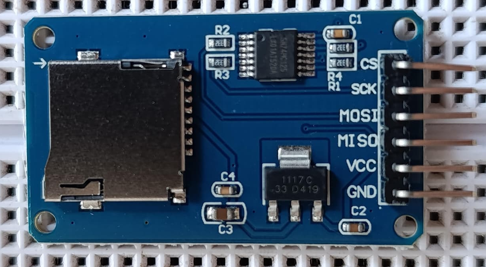
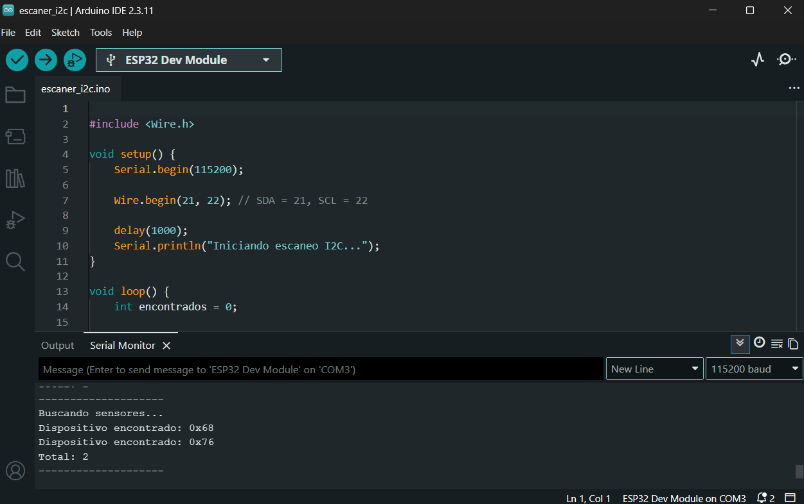
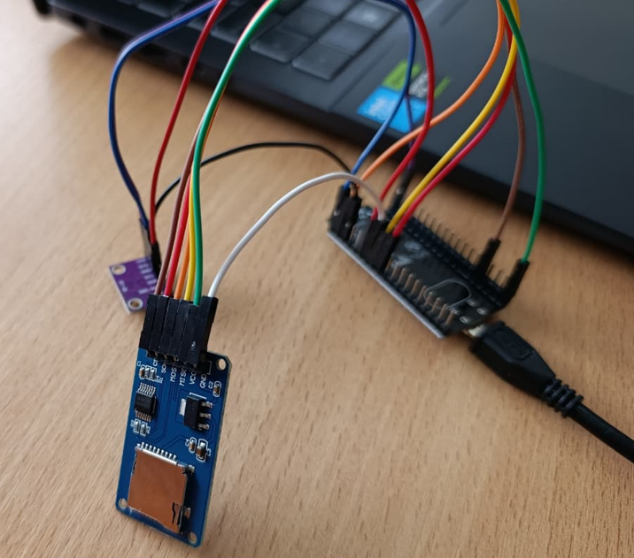
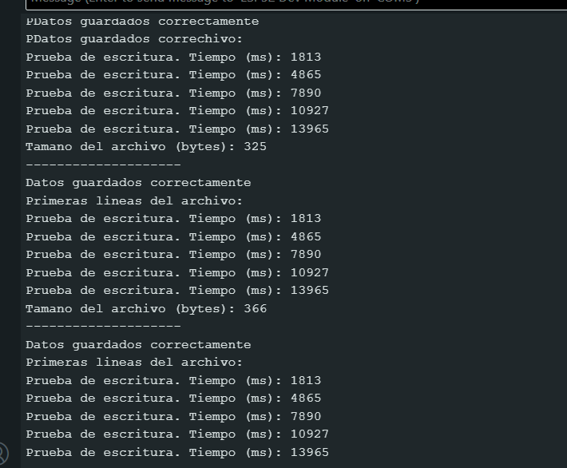

## Entrada 001 — Adquisición de componentes

**Fecha:** 20/11/2026
**Actividad:** Compra de los componentes para la elaboración del proyecto

### Objetivo

Adquirir los componentes necesarios para construir el prototipo.

### Componentes

- ESP32 WROOM-32D
- GY-91 (MPU-9250 y BMP280 responden por I²C)
- Lector microSD SPI
- microSD de 16 GB
- Pulsador de dos patas
- Cable micro-USB
- Protoboard y jumpers


### Procedimiento

Se compararon cotizaciones de distintas tiendas de electrónica y se seleccionaron los componentes de acuerdo con los requisitos del proyecto.

### Decisiones

Se eligió un GY-91 para reunir los sensores inerciales y barométricos en una sola placa.

### Pendientes

- Comprobar comunicación I2C.
- Comprobar el lector microSD.

### Uso de IA

Se utilizó IA para comparar compatibilidad y planificar el montaje. Sus recomendaciones están pendientes de validación física.

## Entrada 002 — Identificación de componentes y preparación del ensamblaje

**Fecha:** 21/11/2026
**Actividad:** Inspección física de los componentes y preparación del primer montaje.

### Objetivo

Identificar los pines y las características principales de los módulos adquiridos para establecer conexiones seguras y preparar las primeras pruebas de comunicación.

### Componentes inspeccionados

- **ESP32-WROOM-32D:** placa de desarrollo de 38 pines, con puerto micro-USB y conversor USB-serie CP2102.
- **GY-91:** módulo multisensor con conexiones I²C y SPI. Se observa un circuito integrado con marcado compatible visualmente con la familia MPU-9250, pendiente de verificación electrónica.
- **Lector microSD SPI:** módulo de seis pines con regulador de 3,3 V identificado en la placa.

### Decisiones técnicas

Se utilizará comunicación I²C entre el ESP32 y el GY-91, mediante GPIO21 (SDA) y GPIO22 (SCL).

Se verificará primero la comunicación y la identidad de los sensores antes de incorporar el sistema de almacenamiento microSD.

### Evidencias

Fotografías de ambas caras del ESP32, GY-91 y lector microSD, almacenadas en `documentacion/fotografias/`.

**ESP32:**


**GY-91:**


Lector microSD:




### Estado

Inspección visual realizada. Pendiente de confirmar comunicación eléctrica, identificadores de sensores y adquisición de datos.

### Uso de IA

Se utilizó ChatGPT como apoyo para interpretar las etiquetas de los componentes, proponer las conexiones y elaborar un programa de identificación I²C. Las recomendaciones serán comprobadas mediante pruebas físicas y comparación con documentación técnica.

## Entrada 003 — Comunicación I²C y primera adquisición de datos crudos

**Fecha:** 21/11/2026
**Actividad:** Configuración del ESP32, identificación de sensores y adquisición inicial de datos.

### Objetivo

Establecer la comunicación entre el ESP32 y el módulo GY-91 mediante el protocolo I²C, verificar la identidad de sus sensores y obtener las primeras mediciones crudas de aceleración, velocidad angular, presión y temperatura.

### Procedimiento

1. Se conectó el módulo GY-91 al ESP32 mediante cuatro conexiones: 3V3, GND, SDA (GPIO21) y SCL (GPIO22).
2. Se configuró Arduino IDE con la placa ESP32 Dev Module y se conectó el microcontrolador mediante un cable micro-USB de datos.
3. Inicialmente, Windows no reconocía correctamente el ESP32, por lo que no era posible seleccionar un puerto COM en Arduino IDE.
4. Se identificó el problema mediante el Administrador de dispositivos y se instaló el controlador CP210x. Posteriormente, se reconoció el puerto COM3.
5. Se ejecutó un programa de escaneo I²C, que detectó dos dispositivos en las direcciones 0x68 y 0x76.
6. Se desarrolló un programa para consultar los identificadores internos de los sensores y obtener sus mediciones crudas.
7. Se corrigió una condición del código que detenía su ejecución cuando el identificador del sensor inercial no coincidía con el esperado.
8. Finalmente, se obtuvieron mediciones de aceleración, giro, presión y temperatura, acompañadas de marcas de tiempo en microsegundos.

### Resultados

El escaneo I²C permitió identificar dos dispositivos:

- **Dirección 0x68:** sensor inercial con identificador 0x70, correspondiente al valor documentado para el MPU-6500.
- **Dirección 0x76:** barómetro con identificador 0x58, correspondiente al BMP280.

Se obtuvieron las primeras mediciones crudas, por ejemplo:

```text
t_us,ax_raw,ay_raw,az_raw,gx_raw,gy_raw,gz_raw,p_raw,t_raw
44861950,712,142,-15858,-46,67,13,479888,534000
```

El eje Z registró aproximadamente -15858 unidades digitales, un valor cercano a la magnitud nominal de la gravedad para la configuración de ±2g, considerando la orientación del sensor.

También se analizaron dos marcas de tiempo consecutivas:

- Primera muestra: 44861950 μs.
- Segunda muestra: 44963950 μs.
- Intervalo: 102000 μs, equivalente a 0,102 s.
- Frecuencia estimada para ese intervalo: aproximadamente 9,80 Hz.

Esta frecuencia corresponde únicamente a la prueba inicial. Todavía será necesario implementar y verificar un muestreo de al menos 100 Hz para cumplir los requisitos del proyecto.

### Problemas encontrados y soluciones

**Problema 1: el ESP32 no era reconocido por Arduino IDE.**

Se resolvió mediante la instalación del controlador USB-serie CP210x.

**Problema 2: el monitor serie no mostraba mediciones.**

El código inicialmente esperaba el identificador 0x71, correspondiente al MPU-9250. Sin embargo, el sensor devolvió 0x70, lo que provocaba que el programa entrara en un bucle infinito y detuviera la adquisición.

Se modificó la condición para aceptar el identificador obtenido y se comprobó que el programa comenzaba a imprimir mediciones.

### Uso de inteligencia artificial

Se utilizó ChatGPT como apoyo para generar código de diagnóstico, interpretar los identificadores de los sensores y solucionar errores de programación.

Se detectó una limitación en el código sugerido inicialmente por la IA, ya que asumía que el módulo contenía necesariamente un MPU-9250. Esta suposición se contrastó con los identificadores obtenidos experimentalmente y con la documentación técnica, permitiendo corregir el programa.

### Evidencias

- Captura de identificación de sensores.



- Captura de pantalla del monitor serie.


- Código `escaner_i2c.ino`.
- Código `lectura_gy91.ino`.
  - Ambos se encuentran en la carpeta firmware/pruebas del proyecto
- Fotografías del montaje.


### Próximas actividades

- Conectar y verificar el módulo lector microSD.
- Comprobar la creación, escritura y lectura de archivos.
- Incorporar un pulsador para registrar eventos.
- Implementar el almacenamiento de datos crudos a una frecuencia mínima de 100 Hz.
- Procesar los registros mediante Python para obtener gráficas en unidades físicas.

## Entrada 004 — Integración y verificación del módulo de almacenamiento microSD

**Fecha:** 24/11/2026
**Actividad:** Conexión del módulo microSD SPI y comprobación de lectura y escritura de archivos.

### Objetivo

Incorporar un sistema de almacenamiento al prototipo de navegación inercial para guardar los datos obtenidos por los sensores sin depender del monitor serie de Arduino IDE.

### Componentes utilizados

- ESP32-WROOM-32D.
- Módulo lector microSD SPI.
- Tarjeta microSD de 16 GB.
- Cables Dupont.
- Cable micro-USB de datos.

### Procedimiento

1. Se mantuvo la conexión I²C previamente establecida entre el ESP32 y el módulo GY-91.
2. Se identificaron los seis pines del lector microSD: CS, SCK, MOSI, MISO, VCC y GND.
3. Se conectó el lector al ESP32 mediante el protocolo SPI, utilizando GPIO13 para CS, GPIO18 para SCK, GPIO23 para MOSI y GPIO19 para MISO.
4. Se utilizó la alimentación correspondiente al módulo, que incorpora un regulador de 3,3 V.
5. Se preparó la tarjeta microSD de 16 GB para su utilización con el sistema de archivos FAT32.
6. Se desarrolló y ejecutó un programa de prueba utilizando las bibliotecas SPI.h y SD.h de Arduino.
7. El programa inicializó la tarjeta, creó el archivo `prueba_sd.txt` y escribió información de prueba.
8. Se comprobó que el archivo podía leerse correctamente después de la escritura.

### Resultados obtenidos

La prueba de almacenamiento fue exitosa. El ESP32 consiguió comunicarse con el lector microSD y escribir información en un archivo.

Esto demuestra que el prototipo cuenta con un medio de almacenamiento funcional, necesario para guardar posteriormente los registros de aceleración, giro y presión.

Sin embargo, todavía no se ha comprobado el funcionamiento a 100 muestras por segundo ni la estabilidad durante registros de larga duración.

### Decisiones técnicas

Se utilizó el protocolo SPI para comunicar el ESP32 con la tarjeta microSD, manteniendo el protocolo I²C para el sensor GY-91.

Se decidió realizar primero una prueba independiente del almacenamiento antes de desarrollar el programa que integra todos los componentes, con el fin de facilitar la identificación de posibles errores.

### Problemas encontrados

No se reportaron errores de escritura o lectura durante la prueba final realizada.

La comprobación de integridad de archivos después de una interrupción inesperada de energía queda pendiente.

### Uso de inteligencia artificial

Se utilizó ChatGPT como apoyo para identificar las conexiones SPI y elaborar el programa de prueba de almacenamiento.

El código fue verificado mediante su ejecución en el ESP32, comprobando que la tarjeta podía almacenar y recuperar la información escrita.

### Evidencias

- Fotografía del módulo lector microSD conectado al ESP32.



- Código `test_microSD.ino` en firmware/pruebas.
- Captura del monitor serie con el resultado de la prueba.



- Archivo `prueba_sd.txt` generado durante el experimento en firmware/archivos_txt_pruebas.

### Próximas actividades

- Incorporar el pulsador para registrar eventos.
- Integrar la lectura del GY-91 con la escritura en la microSD.
- Guardar datos crudos en archivos CSV.
- Implementar un muestreo objetivo de 100 Hz.
- Comprobar los intervalos de adquisición y detectar posibles pérdidas de muestras.
- Preparar el procesamiento y las gráficas mediante Python.

## Entrada 005 — Integración del sistema de adquisición y análisis de frecuencia de muestreo

**Fecha:** 25/11/2026
**Actividad:** Integración del GY-91, almacenamiento microSD y pulsador. Verificación del registro de datos crudos.

### Objetivo

Integrar los componentes principales del dispositivo de navegación inercial para registrar mediciones crudas de aceleración, velocidad angular, presión y temperatura, junto con sus marcas de tiempo y los eventos generados mediante el pulsador.

También se buscó evaluar la frecuencia real de muestreo y verificar la existencia de posibles errores o pérdidas de muestras durante el almacenamiento.

### Componentes utilizados

- ESP32-WROOM-32D.
- Módulo GY-91, con sensor inercial identificado como compatible con MPU-6500 y barómetro BMP280.
- Módulo lector microSD SPI.
- Tarjeta microSD de 16 GB.
- Pulsador de dos patas.
- Protoboard, cables Dupont y cable micro-USB.

### Procedimiento

1. Se conservaron las conexiones I²C entre el ESP32 y el GY-91 mediante GPIO21 (SDA) y GPIO22 (SCL).
2. Se integró el módulo microSD mediante SPI, utilizando GPIO13 (CS), GPIO18 (SCK), GPIO23 (MOSI) y GPIO19 (MISO).
3. Se conectó el pulsador entre GPIO27 y GND, utilizando la resistencia pull-up interna del ESP32.
4. Se desarrolló un programa de adquisición en Arduino IDE para registrar las lecturas crudas de los sensores directamente en un archivo CSV.
5. Se utilizaron marcas de tiempo en microsegundos mediante `esp_timer_get_time()`.
6. Se configuró una frecuencia objetivo de 100 Hz, equivalente a un período de muestreo de 10.000 microsegundos.
7. Se incorporó un mecanismo de detección de eventos mediante pulsador, con un tiempo de estabilización de 30 ms para evitar registros múltiples por rebote.
8. Se ejecutó una prueba de aproximadamente 60 segundos, durante la cual se presionó el pulsador cuatro veces.
9. Se verificó la generación del archivo CSV y se analizó mediante Python utilizando las bibliotecas Pandas y NumPy.
10. Se calcularon la frecuencia media, los intervalos entre mediciones, los intervalos omitidos, los fallos de comunicación y los eventos registrados.

### Resultados obtenidos

| Indicador                      | Resultado |
| ------------------------------ | --------- |
| Duración del registro         | 59,990 s  |
| Muestras registradas           | 5.720     |
| Frecuencia media               | 95,33 Hz  |
| Intervalo promedio             | 10,490 ms |
| Intervalo máximo              | 68,228 ms |
| Intervalos mayores a 15 ms     | 115       |
| Intervalos omitidos acumulados | 280       |
| Fallos de comunicación I²C   | 0         |
| Eventos del pulsador           | 4         |

### Análisis de resultados

Para una frecuencia de 100 Hz durante 60 segundos, se esperaban aproximadamente 6.000 muestras.

Sin embargo, se registraron 5.720, con una frecuencia media de 95,33 Hz. El programa contabilizó 280 intervalos de muestreo omitidos, equivalentes aproximadamente al 4,67 % de los intervalos previstos.

El intervalo promedio fue de 10,490 ms, ligeramente superior al período objetivo de 10 ms. Además, se observó un intervalo máximo de 68,228 ms y un total de 115 intervalos mayores a 15 ms.

Estos resultados indican que el sistema todavía presenta irregularidades en el tiempo de adquisición.

Una posible explicación es que algunas operaciones de almacenamiento en la microSD bloqueen temporalmente la ejecución del programa. También pueden influir los tiempos de comunicación con los sensores y otras operaciones del ciclo principal. Es necesario realizar pruebas adicionales para identificar las causas.

Por otro lado, no se registraron fallos I²C, lo que indica que las lecturas realizadas no reportaron errores de comunicación.

El pulsador funcionó correctamente durante la prueba, registrando cuatro eventos con sus respectivas marcas de tiempo.

### Problemas encontrados

**Frecuencia de muestreo inferior al requisito.**

Aunque se programó una frecuencia objetivo de 100 Hz, el análisis del CSV mostró una frecuencia media de 95,33 Hz y varios intervalos de adquisición omitidos.

Esto demuestra que establecer un período de muestreo en el código no garantiza que el dispositivo consiga mantenerlo durante el registro.

### Decisiones técnicas

Se decidió conservar los datos experimentales originales para utilizarlos como referencia en las siguientes pruebas.

Como posible mejora, se evaluará aumentar la velocidad de comunicación I²C de 100 kHz a 400 kHz y probar una velocidad SPI mayor para la microSD, verificando los resultados después de cada modificación.

Si estas medidas no son suficientes, se estudiará la implementación de un búfer de escritura para reducir el impacto del almacenamiento sobre el muestreo.

### Uso de inteligencia artificial

Se utilizó ChatGPT como apoyo para integrar el código de adquisición, implementar las marcas de tiempo y desarrollar el programa de verificación de registros en Python.

Los resultados obtenidos experimentalmente permitieron identificar que, aunque el código estaba configurado para una frecuencia objetivo de 100 Hz, el dispositivo no lograba mantenerla de forma sostenida.

Este resultado evidencia la necesidad de comprobar experimentalmente el comportamiento del código sugerido por la IA.

### Evidencias

- Código `adquisicion_esp32.ino`.
- Archivo original `datos_001.csv`.
- Archivo de configuración y calibración interna `calib_001.txt`.
- Código de análisis `verificar.py`.
- Captura de los resultados del análisis en Python.
- Fotografías del montaje completo.

### Pruebas adicionales de optimización de la frecuencia de muestreo

Se realizaron dos pruebas adicionales de 60 segundos para evaluar el efecto de modificar las velocidades de comunicación del sistema.

**Prueba CSV 003 — I²C a 400 kHz y SPI a 1 MHz**

Se aumentó la velocidad de comunicación I²C de 100 kHz a 400 kHz, manteniendo la configuración anterior de la microSD.

Se obtuvieron 5.708 muestras, una frecuencia media de 95,13 Hz y 292 intervalos de muestreo omitidos. El intervalo máximo fue de 70,977 ms y no se registraron errores I²C.

Los resultados no mostraron una mejora respecto a la prueba inicial, que había alcanzado 95,33 Hz.

**Prueba CSV 004 — I²C a 400 kHz y SPI a 4 MHz**

Se mantuvo la velocidad I²C de 400 kHz y se aumentó la velocidad SPI de 1 MHz a 4 MHz.

Se registraron 5.970 muestras durante 59,990 segundos, alcanzando una frecuencia media de 99,50 Hz.

El número de intervalos omitidos disminuyó a 30, mientras que el intervalo máximo se redujo a 31,526 ms. También se registraron tres eventos mediante el pulsador y no se presentaron errores I²C.

**Análisis comparativo**

La segunda configuración produjo una mejora considerable. Respecto al CSV 003, la frecuencia media aumentó 4,37 Hz y los intervalos omitidos disminuyeron aproximadamente un 89,7 %.

Estos resultados sugieren que la velocidad de comunicación con la microSD influye en el rendimiento del sistema. Sin embargo, se requieren pruebas adicionales para confirmar esta relación.

Aunque se alcanzó una frecuencia media cercana a 100 Hz, todavía existen intervalos omitidos y pausas superiores al período de muestreo objetivo.

**Decisiones y próximos pasos**

Se decidió conservar la configuración I²C de 400 kHz y SPI de 4 MHz.

Además, se identificó que el divisor de frecuencia interno del MPU-6500 estaba configurado para una actualización de 100 Hz. Se propone aumentar su frecuencia interna a 200 Hz y utilizar un período de adquisición de 9.500 microsegundos para evaluar si el registrador puede superar los 100 Hz reales.

Las pruebas realizadas se conservarán en el repositorio para documentar el proceso de optimización y justificar las decisiones técnicas.

### Estado del proyecto

Se ha logrado integrar los sensores, el almacenamiento microSD y el pulsador en un mismo sistema de adquisición.

El dispositivo puede registrar datos crudos y eventos en archivos que posteriormente se procesan mediante Python.

La comunicación I²C no reportó fallos durante la prueba, pero la frecuencia media obtenida todavía es inferior a los 100 Hz requeridos. Por tanto, queda pendiente optimizar y verificar el rendimiento del sistema.

### Próximas actividades

- Realizar nuevas pruebas de frecuencia de muestreo.
- Comparar los resultados antes y después de las modificaciones.
- Generar gráficas de aceleración, velocidad angular y presión.
- Realizar el experimento de reposo.
- Realizar el experimento de seis caras para caracterizar y calibrar el acelerómetro.
- Analizar el crecimiento del error mediante integración numérica.
