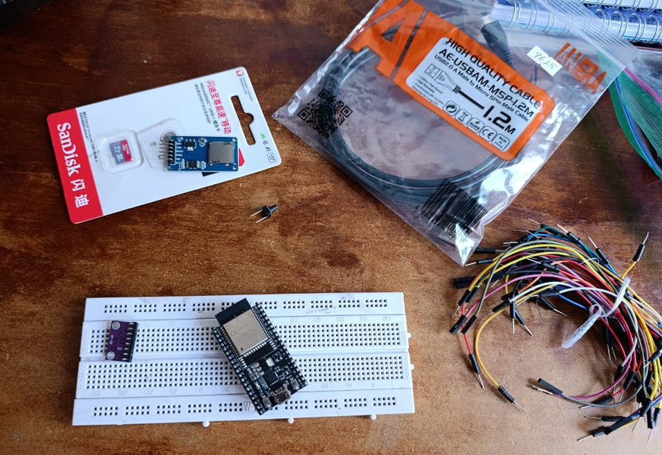
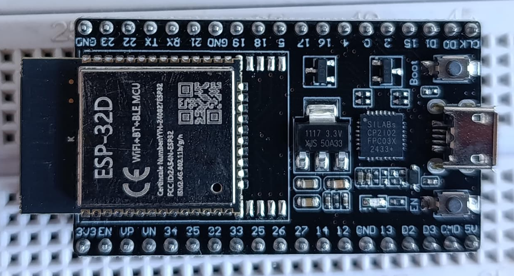
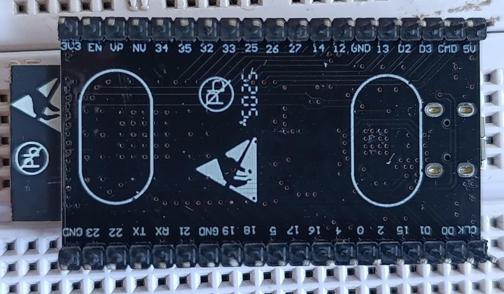
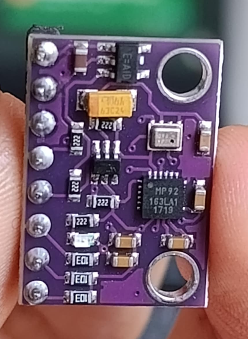
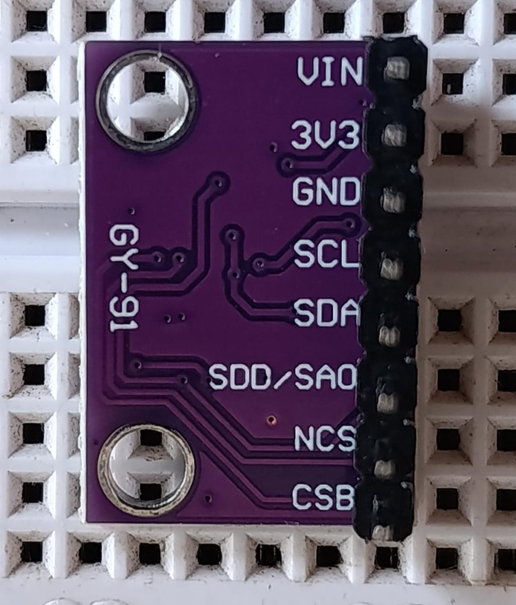
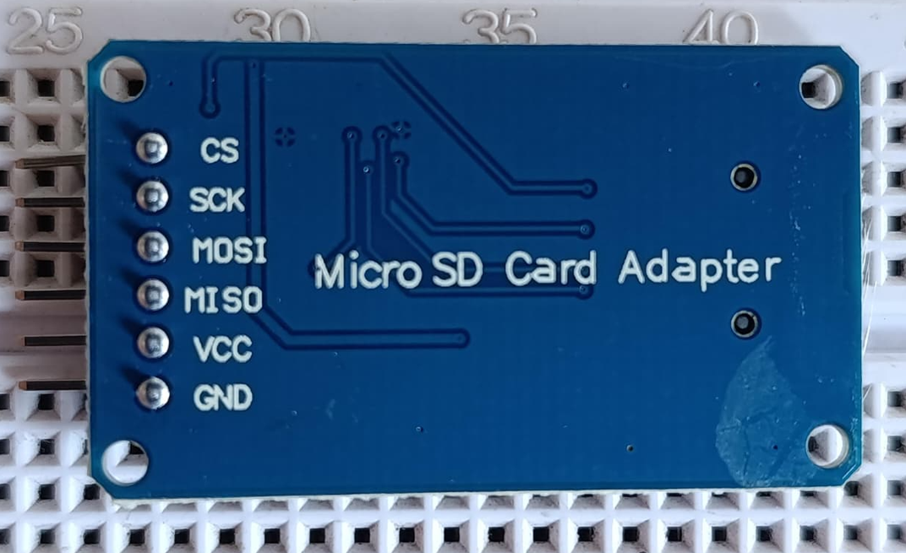
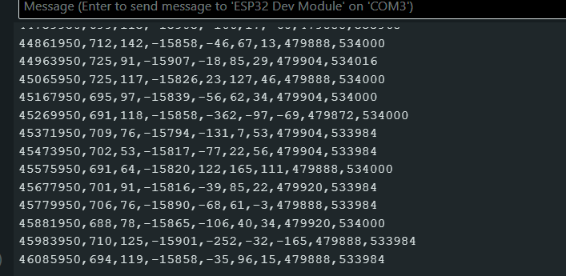
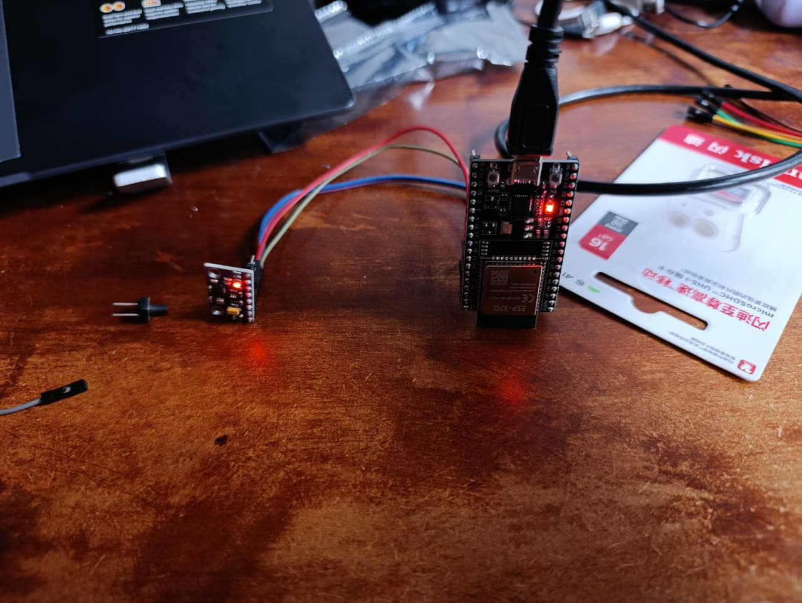

## Entrada 001 — Adquisición de componentes

**Fecha:** 20/11/2026
**Responsables:** Stephanie Lozada
**Actividad:** Compra de los componentes para la elaboración del proyecto

### Objetivo

Adquirir los componentes necesarios para construir el prototipo.

### Componentes

- ESP32 WROOM-32D
- GY-91 (MPU-9250 y BMP280 responden por I²C)
- Lector microSD SPI
- microSD de 16 GB
- Pulsador de dos patas
- Cable micro-USB
- Protoboard y jumpers



### Procedimiento

Se compararon cotizaciones de distintas tiendas de electrónica y se seleccionaron los componentes de acuerdo con los requisitos del proyecto.

### Decisiones

Se eligió un GY-91 para reunir los sensores inerciales y barométricos en una sola placa.

### Pendientes

- Comprobar comunicación I2C.
- Comprobar el lector microSD.

### Uso de IA

Se utilizó IA para comparar compatibilidad y planificar el montaje. Sus recomendaciones están pendientes de validación física.

## Entrada 002 — Identificación de componentes y preparación del ensamblaje

**Fecha:** 21 de noviembre de 2026
**Responsables:** Stephanie Lozada
**Actividad:** Inspección física de los componentes y preparación del primer montaje.

### Objetivo

Identificar los pines y las características principales de los módulos adquiridos para establecer conexiones seguras y preparar las primeras pruebas de comunicación.

### Componentes inspeccionados

- **ESP32-WROOM-32D:** placa de desarrollo de 38 pines, con puerto micro-USB y conversor USB-serie CP2102.
- **GY-91:** módulo multisensor con conexiones I²C y SPI. Se observa un circuito integrado con marcado compatible visualmente con la familia MPU-9250, pendiente de verificación electrónica.
- **Lector microSD SPI:** módulo de seis pines con regulador de 3,3 V identificado en la placa.

### Decisiones técnicas

Se utilizará comunicación I²C entre el ESP32 y el GY-91, mediante GPIO21 (SDA) y GPIO22 (SCL).

Se verificará primero la comunicación y la identidad de los sensores antes de incorporar el sistema de almacenamiento microSD.

### Evidencias

Fotografías de ambas caras del ESP32, GY-91 y lector microSD, almacenadas en `documentacion/fotografias/`.

**ESP32:**





**GY-91:**





Lector microSD:




### Estado

Inspección visual realizada. Pendiente de confirmar comunicación eléctrica, identificadores de sensores y adquisición de datos.

### Uso de IA

Se utilizó ChatGPT como apoyo para interpretar las etiquetas de los componentes, proponer las conexiones y elaborar un programa de identificación I²C. Las recomendaciones serán comprobadas mediante pruebas físicas y comparación con documentación técnica.

## Entrada 003 — Comunicación I²C y primera adquisición de datos crudos

**Fecha:** 21/11/2026
**Responsable:** Stephanie Lozada
**Actividad:** Configuración del ESP32, identificación de sensores y adquisición inicial de datos.

### Objetivo

Establecer la comunicación entre el ESP32 y el módulo GY-91 mediante el protocolo I²C, verificar la identidad de sus sensores y obtener las primeras mediciones crudas de aceleración, velocidad angular, presión y temperatura.

### Procedimiento

1. Se conectó el módulo GY-91 al ESP32 mediante cuatro conexiones: 3V3, GND, SDA (GPIO21) y SCL (GPIO22).
2. Se configuró Arduino IDE con la placa ESP32 Dev Module y se conectó el microcontrolador mediante un cable micro-USB de datos.
3. Inicialmente, Windows no reconocía correctamente el ESP32, por lo que no era posible seleccionar un puerto COM en Arduino IDE.
4. Se identificó el problema mediante el Administrador de dispositivos y se instaló el controlador CP210x. Posteriormente, se reconoció el puerto COM3.
5. Se ejecutó un programa de escaneo I²C, que detectó dos dispositivos en las direcciones 0x68 y 0x76.
6. Se desarrolló un programa para consultar los identificadores internos de los sensores y obtener sus mediciones crudas.
7. Se corrigió una condición del código que detenía su ejecución cuando el identificador del sensor inercial no coincidía con el esperado.
8. Finalmente, se obtuvieron mediciones de aceleración, giro, presión y temperatura, acompañadas de marcas de tiempo en microsegundos.

### Resultados

El escaneo I²C permitió identificar dos dispositivos:

- **Dirección 0x68:** sensor inercial con identificador 0x70, correspondiente al valor documentado para el MPU-6500.
- **Dirección 0x76:** barómetro con identificador 0x58, correspondiente al BMP280.

Se obtuvieron las primeras mediciones crudas, por ejemplo:

```text
t_us,ax_raw,ay_raw,az_raw,gx_raw,gy_raw,gz_raw,p_raw,t_raw
44861950,712,142,-15858,-46,67,13,479888,534000
```

El eje Z registró aproximadamente -15858 unidades digitales, un valor cercano a la magnitud nominal de la gravedad para la configuración de ±2g, considerando la orientación del sensor.

También se analizaron dos marcas de tiempo consecutivas:

- Primera muestra: 44861950 μs.
- Segunda muestra: 44963950 μs.
- Intervalo: 102000 μs, equivalente a 0,102 s.
- Frecuencia estimada para ese intervalo: aproximadamente 9,80 Hz.

Esta frecuencia corresponde únicamente a la prueba inicial. Todavía será necesario implementar y verificar un muestreo de al menos 100 Hz para cumplir los requisitos del proyecto.

### Problemas encontrados y soluciones

**Problema 1: el ESP32 no era reconocido por Arduino IDE.**

Se resolvió mediante la instalación del controlador USB-serie CP210x.

**Problema 2: el monitor serie no mostraba mediciones.**

El código inicialmente esperaba el identificador 0x71, correspondiente al MPU-9250. Sin embargo, el sensor devolvió 0x70, lo que provocaba que el programa entrara en un bucle infinito y detuviera la adquisición.

Se modificó la condición para aceptar el identificador obtenido y se comprobó que el programa comenzaba a imprimir mediciones.

### Uso de inteligencia artificial

Se utilizó ChatGPT como apoyo para generar código de diagnóstico, interpretar los identificadores de los sensores y solucionar errores de programación.

Se detectó una limitación en el código sugerido inicialmente por la IA, ya que asumía que el módulo contenía necesariamente un MPU-9250. Esta suposición se contrastó con los identificadores obtenidos experimentalmente y con la documentación técnica, permitiendo corregir el programa.

### Evidencias

- Captura de identificación de sensores.


- Captura de pantalla del monitor serie.



- Código `escaner_i2c.ino`.
- Código `lectura_gy91.ino`.
  - Ambos se encuentran en la carpeta firmware/pruebas del proyecto
- Fotografías del montaje.




### Próximas actividades

- Conectar y verificar el módulo lector microSD.
- Comprobar la creación, escritura y lectura de archivos.
- Incorporar un pulsador para registrar eventos.
- Implementar el almacenamiento de datos crudos a una frecuencia mínima de 100 Hz.
- Procesar los registros mediante Python para obtener gráficas en unidades físicas.
