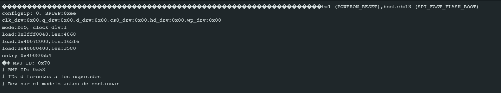

## Caso 001 — Identificación incorrecta del sensor inercial

**Fecha:** 21/11/2026

### Situación

Durante el desarrollo del código para la adquisición de datos, se utilizó ChatGPT como apoyo para identificar y configurar los sensores del módulo GY-91.

Inicialmente, el programa asumía que el sensor inercial correspondía a un MPU-9250, cuyo identificador esperado es `0x71`.

### Problema encontrado

Al ejecutar el programa en el ESP32, el monitor serie mostró los siguientes resultados:

- Identificador del sensor inercial: `0x70`.
- Identificador del barómetro: `0x58`.

Como el código esperaba exclusivamente `0x71` para el sensor inercial, la ejecución se detenía y no se mostraban las mediciones.

#### Evidencia de la salida en el monitor serial de Arduino IDE

### Verificación

Se comparó el identificador obtenido con los mapas de registros de los sensores MPU-9250 y MPU-6500.

Se encontró que `0x70` corresponde al identificador documentado para el MPU-6500, mientras que `0x71` corresponde al MPU-9250.

Por tanto, existe evidencia de que el módulo adquirido contiene un sensor inercial diferente al anunciado comercialmente.

### Corrección

Se modificó la validación del programa para admitir los identificadores correspondientes al MPU-6500 y al MPU-9250.

La adquisición de datos y la identificación definitiva del hardware quedan pendientes de comprobar mediante pruebas adicionales.

### Conclusión

El caso demuestra la importancia de verificar las recomendaciones de la IA mediante resultados experimentales y documentación técnica, en lugar de asumir que el modelo comercial identifica correctamente los componentes internos del dispositivo.
